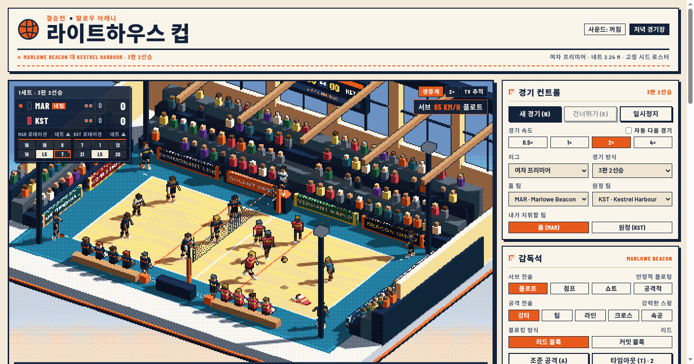
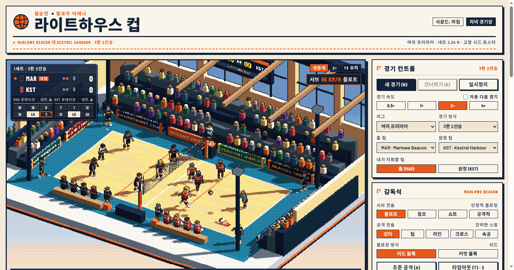
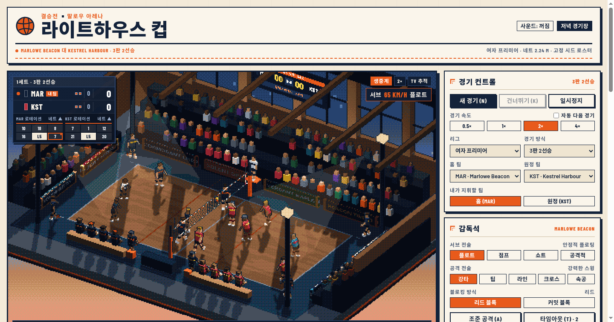
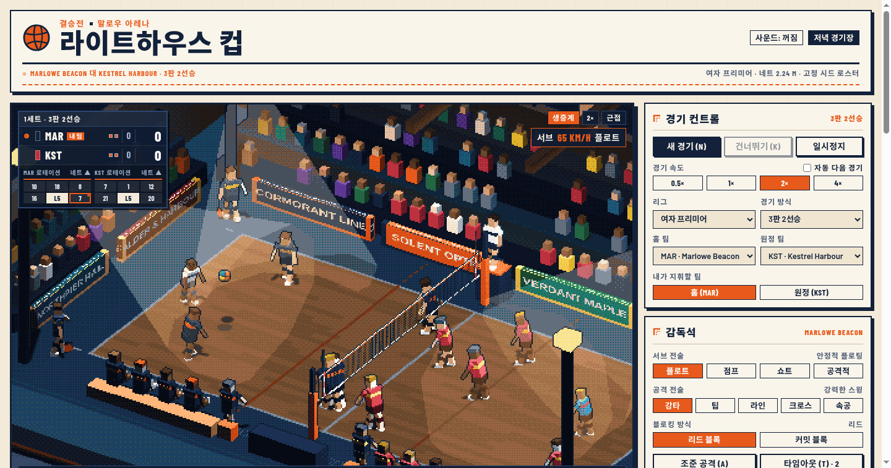
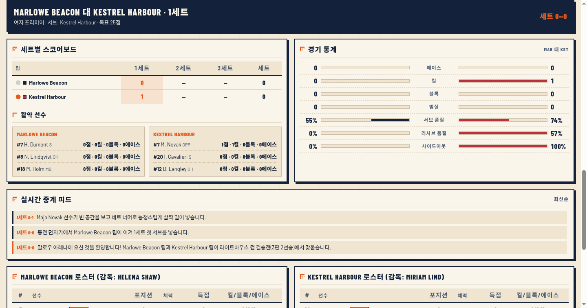

<div align="center">

# 🏐 라이트하우스 컵 (Lighthouse Cup) 한글판

**브라우저에서 바로 돌아가는 픽셀 아트 3D 배구 매치 센터**

여자 / 남자 프리미어 리그 · 3판 2선승 / 5판 3선승 · 실시간 중계 · 라인 콜 비디오 판독 · 웹 오디오 관중 소리

[**▶ 한글판 플레이**](https://sigco3111.github.io/lighthouse-cup-ko/) · [원본 저장소](https://github.com/itsLucas02/lighthouse-cup) · [원본 플레이](https://lighthouse-cup.pages.dev)



</div>

## 소개

라이트하우스 컵은 배구 매니지먼트 + 경기 시뮬레이션 게임입니다. 리그, 두 팀, 경기 방식을 고른 뒤 사이드라인에서 감독이 되어 서브와 공격 전술을 정하고, 타임아웃을 부르고, 비디오 챌린지를 쓰고, 선수를 교체합니다. 그동안 디더링된 픽셀 아트 3D 디오라마가 랠리를 그려 냅니다.

원본은 `index.html` 파일 하나로 된 게임이며 빌드 과정과 서버가 필요 없습니다. 이 저장소는 그 원본의 **한글화 버전**입니다.

## 한글화 범위

- 화면의 모든 버튼, 라벨, 패널 제목, 툴팁, 키보드 단축키 안내
- 경기 중 이벤트 자막(에이스, 킬, 스터프 블록, 서브 범실 등)과 세트/매치 포인트 표시
- 실시간 중계 문장 (득점 유형별 문장, 타임아웃, 선수 교체, 세트 종료, 우승 멘트)
- 비디오 판독 화면, 경기장 3D 전광판과 코트 바닥 문구
- 세트별 스코어보드, 경기 통계, 활약 선수, 로스터 표
- 한글이 깨지지 않도록 Noto Sans KR 글꼴을 추가
- 팀 이름, 선수 이름, 감독 이름, 스폰서 보드는 가상의 고유명사이므로 원문 그대로 유지했습니다.
- 배구 포지션 약어(S, OH, MB, OPP, L)와 팀 코드(MAR, KST 등)도 그대로 유지했습니다.

## 스크린샷

| 낮 경기 | 저녁 경기장 |
| --- | --- |
|  |  |

| 쇼 조명 + 근접 카메라 | 매치 센터 |
| --- | --- |
|  |  |

## 주요 기능

- **두 개의 리그**: 여자 프리미어(네트 2.24 m), 남자 프리미어(네트 2.43 m), 각 5개 팀
- **경기 방식**: 퀵 세트(15점), 단판 세트(25점), 3판 2선승, 5판 3선승
- **감독석**: 서브 전술(플로트 · 점프 · 쇼트 · 공격적), 공격 전술(강타 · 팁 · 라인 · 크로스 · 속공), 블로킹 방식(리드 / 커밋), 조준 공격, 타임아웃, 선수 교체
- **비디오 챌린지**: 라인 콜이 아슬아슬하면 챌린지를 걸어 판정을 뒤집거나 확인
- **연출**: OKLab 디더링 픽셀 파이프라인, 조명 3종(낮 · 저녁 · 쇼), 바닥 4종(메이플 · 타라플렉스 · 파르케 · 고무), 카메라 3종

## 조작

| 키 | 동작 |
| --- | --- |
| `Space` | 일시정지 / 재개 |
| `N` | 새 경기 |
| `K` | 오프닝 건너뛰기 |
| `T` | 타임아웃 |
| `C` | 라인 판정 챌린지 |
| `A` | 조준 공격 켜기/끄기 |
| `S` | 코트 바닥 변경 |
| `L` | 조명 변경 |
| `Q` / `E` | 카메라 좌 / 우 회전 |
| `1` `2` `3` | TV 추적 / 경기장 전체 / 근접 |
| `R` | 카메라 초기화 |
| `Esc` | 조준 모드 취소 |
| 휠 | 확대 / 축소 |

화면의 버튼으로도 모두 조작할 수 있습니다.

## 설치 및 실행

```bash
git clone https://github.com/sigco3111/lighthouse-cup-ko.git
cd lighthouse-cup-ko
python3 -m http.server 8000
# 브라우저에서 http://localhost:8000 접속
```

`index.html`을 브라우저로 직접 열어도 됩니다. Three.js, Tailwind 브라우저 빌드, 글꼴을 CDN에서 불러오므로 처음 로딩할 때는 인터넷 연결이 필요합니다.

## 기술 메모

- 순수 HTML / CSS / JavaScript 단일 파일, Three.js r128 (WebGL)
- 원본 로직은 건드리지 않고 화면에 보이는 문자열만 한국어로 바꿨습니다. 한국어 조사가 어색해지지 않도록 중계 문장은 `선수` / `팀` 같은 말을 붙여 이름 뒤 조사가 항상 맞게 했습니다.
- GitHub Pages에서 정적 파일로 바로 배포됩니다. 원본의 `_headers`, `_redirects`는 Cloudflare Pages용이라 여기서는 쓰이지 않습니다.
- 사운드는 Web Audio로 합성되며 기본값은 꺼짐입니다.
- 테스트 환경은 소프트웨어 렌더링이라 실제 GPU, 모바일 터치, 소리 재생, 끝까지 한 경기를 마치는 흐름은 직접 확인하지 못했습니다.

## 라이선스와 원작자 표기

- 원작: **itsLucas02 / lighthouse-cup** (저작권 (c) 2026 Aizzul Luqman), MIT License. 원본 README에 따르면 **gemini-4-carbon**이 하나의 프롬프트로 만든 작품이며 프롬프트는 [`docs/PROMPT.md`](docs/PROMPT.md)에 그대로 보존되어 있습니다.
- 원본 저장소: https://github.com/itsLucas02/lighthouse-cup
- 이 한글화 버전도 같은 MIT License를 따릅니다. 자세한 내용은 [`LICENSE`](LICENSE)를 보세요.
